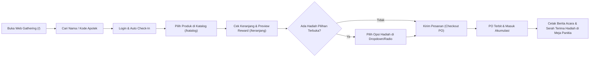
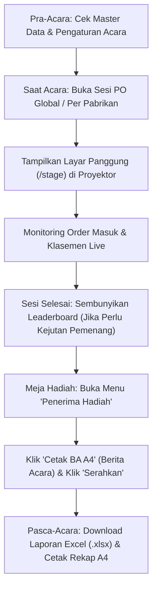

# Panduan Sistem & Alur Program SMS Gathering Order

Dokumen ini merangkum alur kerja (*user flow*) setiap aktor, logika pengaturan acara, aturan perhitungan *reward* & *tier* seluruh 9 pabrikan, mekanisme *leaderboard*, serta panduan persiapan (*checklist*) sebelum sesi *order* dimulai.

---

## 1. Daftar Aktor & Fitur Utama

Sistem **SMS Gathering & Order** memiliki **3 antarmuka utama** yang saling terhubung secara *real-time*:

| Aktor / Peran | URL Akses | Fungsi & Fitur Utama |
| :--- | :--- | :--- |
| **1. Tamu Apotek (Guest)** | `/` (Halaman Utama) | • Login instan dengan **Kode Apotek** atau pencarian **Nama Apotek** (otomatis *Check-In* kehadiran). • Melihat **Katalog Produk** per pabrikan beserta indikator waktu sesi PO. • **Keranjang Belanja Pintar**: menghitung proyeksi *reward* otomatis & menampilkan opsi **Hadiah Pilihan** yang terbuka. • Melihat **Riwayat PO** dan akumulasi perolehan *voucher* & hadiah fisik. • Memantau **Live Leaderboard** (`/leaderboard`) dari *smartphone* masing-masing. |
| **2. Layar Panggung (Stage Display)** | `/stage` | • Tampilan proyektor ukuran penuh (*1920x1080*) yang melakukan *auto-refresh* & rotasi tab otomatis. • Menampilkan **Podium Top 3 Most Spender**, klasemen peringkat keseluruhan (*Overall*), serta klasemen per pabrikan. • Menampilkan **Grand Prize Elektronik PT. Graha Farma** (Juara 1–3). • Menampilkan kartu *Doorprize* dan **Teks Berjalan (*Running Ticker*)**. |
| **3. Admin & Panitia (Backoffice)** | `/admin` | • **Dashboard Eksekutif**: memantau total GMV, jumlah PO masuk, kehadiran apotek, Top 5 Spender & Produk. • **Pengaturan Acara & Sesi PO**: membuka/menutup sesi PO global maupun per pabrikan (dengan *timer* 15–60 menit atau *unlimited*). • **Kelola Data Master**: Apotek, Pabrikan, Produk, dan koreksi PO. • **5 Laporan Gathering**: Penerima Hadiah (serah terima), Produk Terjual, Omset Pabrikan, Peringkat Apotek, dan Belanja Per Apotek. • **Export Excel (`.xlsx`) Tabel Berformat** & **Cetak Laporan A4 / Berita Acara Serah Terima**. |

---

## 2. Alur Program (*User Flow*) Tiap Aktor

### A. Alur Tamu Apotek (*Guest Flow*)

1. **Masuk & Registrasi Kehadiran**: Tamu mengetikkan nama atau kode apotek di halaman depan. Saat masuk, status kehadiran apotek (`is_checked_in`) otomatis tercatat **Hadir**.
   * *Proteksi Perangkat*: 1 akun apotek hanya aktif di 1 perangkat pada satu waktu. Jika apotek berganti HP, tersedia modal konfirmasi **Ambil Alih Sesi (*Takeover*)**.
2. **Belanja Katalog**: Tamu memilih produk dari pabrikan yang sesinya sedang **Buka**. Produk dengan aturan khusus (seperti *Flucadex Syr* kelipatan 24 botol) otomatis mengikuti *stepper* kelipatannya.
3. **Evaluasi Keranjang & Pilih Hadiah**: Di halaman keranjang, sistem menggabungkan isi keranjang saat ini dengan riwayat PO sebelumnya untuk menampilkan:
   * Hadiah fisik & *voucher* yang otomatis didapatkan.
   * Kotak pemilihan hadiah (khusus produk **Exeltis**, **Interbat**, atau **Neo Protifed** yang ada di keranjang saat ini).
4. **Checkout & Order Susulan**: Tamu dapat membuat PO berkali-kali (PO susulan). Seluruh PO yang berstatus *Confirmed* akan **diakumulasikan** (tidak hangus per transaksi).

---

### B. Alur Admin & Panitia (*Admin Flow*)

---

## 3. Logika Pengaturan Event & Sesi Pemesanan

Pengaturan acara dikendalikan melalui menu **Sistem & Pengaturan -> Pengaturan Acara**:

1. **Identitas & Banner Registrasi**:
   * **Nama Acara & Lokasi Venue**: Tampil di halaman login tamu, header aplikasi, dan kop laporan.
   * **Jadwal Meja Registrasi & Catatan Bantuan (Opsional)**: Jika diisi, akan memunculkan *banner* informasi kuning di halaman login tamu. **Jika dikosongkan atau diisi `-`, maka *banner* kuning otomatis disembunyikan.**
2. **Kontrol Sesi Pemesanan Global**:
   * Memiliki saklar utama **Aktifkan Sesi Pemesanan (Global)** serta rentang waktu mulai (`session_start_at`) dan berakhir (`session_end_at`).
   * Jika saklar global dimatikan atau waktu acara telah lewat, seluruh tombol tambah keranjang & *checkout* akan terkunci.
3. **Kontrol Sesi PO per Pabrikan (Flash Deal / Sesi Presentasi)**:
   * Admin dapat membuka/menutup sesi pemesanan **spesifik per pabrikan** (misal saat pabrik sedang presentasi di panggung):
     * **Buka 15 / 30 / 45 / 60 Menit**: Membuka keranjang khusus pabrikan tersebut dengan hitung mundur (*countdown timer*).
     * **+15m**: Memperpanjang waktu sesi pabrikan yang sedang berjalan.
     * **Buka Penuh (*Unlimited*)**: Membuka pemesanan pabrikan tanpa batas waktu.
     * **Tutup**: Mengunci pemesanan pabrikan tersebut.
4. **Kontrol Layar Panggung & Pengumuman**:
   * **Tampilkan Papan Peringkat Live**: Dapat dimatikan sementara menjelang pengumuman pemenang utama agar peringkat menjadi kejutan (*blind mode*).
   * **Pengumuman Doorprize & Running Ticker**: Teks pengumuman yang tampil bergerak di bagian bawah layar panggung dan halaman peringkat tamu.

---

## 4. Logika Order & Perhitungan Reward 9 Pabrikan

**Ketentuan Umum Program Gathering:**
1. **Program Berlaku Selama 3 Bulan, Tetapi Wajib Deal pada Saat Acara** (ditampilkan pada *banner* Katalog & Keranjang).
2. **Semua Program Berlaku Kelipatan** dan dihitung berdasarkan **Akumulasi Akun Apotek** (pembelian pada PO-1, PO-2, dst saling melengkapi dan tidak hangus).
3. Semua produk wajib diorder minimal **1 Box**, **kecuali Flucadex Syr (`GRH-008`) wajib minimal & kelipatan 24 Fls (1 Paket = 24 Fls)**.

Berikut adalah rincian logika perhitungan *reward* untuk masing-masing pabrikan:

### 1. PT. ZENITH PHARMA & BUFA (`zenith-bufa`)
* **Bonus Paket Belanja (Kelipatan Rp 1.500.000,- = 1 Paket)**:
  * Pencapaian **1 Paket** (Rp 1,5 Jt – Rp 2,99 Jt): **1 Pcs Tumbler**.
  * Pencapaian **>= 2 Paket** (>= Rp 3 Jt): **Tumbler & Sarung** sejumlah paket yang dicapai (misal 2 Paket = 2 Tumbler + 2 Sarung).
* **Bonus Kuantitas Produk Spesifik (Berlaku Kelipatan)**:
  * **Flumin Plus (`ZNT-021`)**: Setiap kelipatan **50 Box** -> **1 Unit Chopper**.
  * **Zenpepsa (`ZNT-045`)**: Setiap kelipatan **180 Fls** -> **1 Unit Wajan Serbaguna**.
  * **Flamifa (`ZNT-018`)**: Setiap kelipatan **75 Box** -> **1 Unit Electric Cooker**.

### 2. PT. GRAHA FARMA (`graha-farma`)
* **Aturan Khusus Produk**:
  * **Flucadex Syr (`GRH-008`)**: Minimal order **24 Fls** dan *step-up* kelipatan **24 Fls**.
* **Program Reguler (Gabungan Seluruh Produk Graha Kecuali Neo Protifed)**:
  * Setiap **99 Box/Fls** dihitung sebagai **1 Paket Reguler**.
  * **1–2 Paket**: Voucher Belanja **Rp 100.000,- per paket**.
  * **Kelipatan 3 Paket (297 Box)**: Mendapatkan **Voucher Belanja Rp 500.000,-** untuk setiap 3 paket, ditambah Rp 100.000,- untuk sisa paketnya.
* **Program Khusus Neo Protifed (`GRH-019`)**:
  * Setiap kelipatan **25 Box** -> **Voucher Rp 50.000,-** + **1x Hadiah Pilihan** (*Magic Com Cosmos* atau *Mixer Miyako*).
* **Grand Prize Elektronik (Khusus Acara Hari Ini)**:
  * Diurutkan berdasarkan **Jumlah Paket Reguler Terbanyak** (minimal 1 paket):
    * **Juara 1**: 1 Unit Smart TV Polytron 32 Inch
    * **Juara 2**: 1 Unit Dispenser Cosmos Galon Bawah
    * **Juara 3**: 1 Unit Kipas Angin Cosmos

### 3. PT. MEPRO (`mepro`)
* **Bonus Voucher per Produk (Kelipatan 50 Box)**:
  * **Cefixime 100 (`MEP-001`)**: Setiap 50 Box -> Voucher **Rp 100.000,-**.
  * **Cefadroxil 500 (`MEP-002`)**: Setiap 50 Box -> Voucher **Rp 100.000,-**.
  * **Mezac 50 (`MEP-003`)**: Setiap 50 Box -> Voucher **Rp 50.000,-**.
  * **Intunal Forte (`MEP-004`)**: Setiap 50 Box -> Voucher **Rp 100.000,-**.
* **Bonus Bundle "Program Diambil Semua"**:
  * Jika apotek mengambil **keempat produk di atas sekaligus** masing-masing minimal **50 Box** (berlaku kelipatan) -> Ekstra **1 Buah Magic Com** per bundle.

### 4. INTERBAT (`interbat`)
* **Bonus Paket Belanja (Kelipatan Rp 2.500.000,- = 1 Paket)**:
  * Setiap kelipatan **Rp 2.500.000,-** berhak memilih **1x Hadiah Pilihan** di keranjang:
    * *Elektrik Kettle* / *Panci Kuah* / *Panci Mini Listrik*.
* **Tambahan Voucher Belanja Bertingkat**:
  * Mencapai **2 Paket** (Rp 5.000.000,-): Tambahan Voucher **Rp 50.000,-**.
  * Mencapai **3 Paket** (Rp 7.500.000,-): Tambahan Voucher **Rp 125.000,-**.
  * Mencapai **>= 4 Paket** (Rp 10.000.000,-): Tambahan Voucher **Rp 300.000,-** per kelipatan 4 paket.

### 5. ERITA (`erita`)
* **Etapril (`ERT-001`)**: Setiap kelipatan **100 Box** -> **1 Buah Rice Cooker**.

### 6. ARTO FARMA (`arto-farma`)
* **Arflam 50mg (`ART-001`)**: Setiap kelipatan **100 Box** -> **1 Unit Kipas Angin Sogo**.

### 7. YARINDO (`yarindo`)
* **Furosemide 40mg (`YAR-001`)**: Setiap kelipatan **78 Box** -> **1 Buah Kain Batik**.

### 8. DEXA (`dexa`)
* **Dexamol (`DXA-001`)**: Setiap kelipatan **100 Box** -> **1 Tumbler/Mug + Voucher Rp 50.000,-**.
* **Verbetin (`DXA-002`)**: Setiap kelipatan **70 Fls** -> **1 Tumbler/Mug + Voucher Rp 50.000,-**.
* **Meticon (`DXA-003`)**: Setiap kelipatan **70 Fls** -> **1 Tumbler/Mug + Voucher Rp 50.000,-**.

### 9. EXELTIS (`exeltis`)
* Menggunakan sistem **Bebas Pilih Hadiah Berdasarkan Tier Kuantitas** pada produk yang dipesan di keranjang:
  * **Lansoprazole (`EXE-001`)**:
    * **Tier 5 Box**: Voucher Rp 50.000 / Tumbler
    * **Tier 10 Box**: Panci Listrik / Teko Listrik / Kipas Angin / Setrika / Blender
    * **Tier 20 Box**: Panci Set / Magic Com 2L / Kompor Gas 2 Tungku / Dispenser
    * **Tier 40 Box**: Air Fryer / Speaker Aktif / Oven Listrik / Presto
    * **Tier 60 Box**: Vacuum Cleaner / Dispenser Galon Bawah / Microwave / Smart Watch
    * **Tier 100 Box**: Logam Mulia 1 Gr / Kulkas 1 Pintu / Mesin Cuci / TV 24"
    * **Tier 150 Box**: TV 32" Smart / Kulkas 2 Pintu / Sepeda Lipat / HP Android
    * **Tier 200 Box**: Panci Set 3 in 1 / Logam Mulia 2,5 Gr / TV 43" / AC 1/2 PK / Mesin Cuci 1 Tabung
    * **Tier 500 Box**: Sepeda Listrik / Logam Mulia 5 Gr / Smart TV 55" / Kulkas Side-by-Side / Laptop
  * **Sucralfate (`EXE-002` 60ml + `EXE-003` 100ml digabung)**:
    * Memiliki struktur *tier* **5, 10, 20, 40, 60, 100, 150, 200, hingga 500 Botol** (mulai dari Voucher Rp 50rb, Speaker Aktif pada Tier 40 Botol, hingga hadiah elektronik utama).
  * *Pengaman Order Susulan*: Pilihan hadiah Lansoprazole hanya muncul di keranjang jika keranjang saat itu berisi Lansoprazole (>= 5 Box), dan pilihan hadiah Sucralfate hanya muncul jika keranjang saat itu berisi Sucralfate (>= 5 Botol).

---

## 5. Logika Perhitungan Leaderboard & *Tie-Breaker*

1. **Peringkat Utama (*Overall Most Spender*) & Peringkat Pabrikan Reguler**:
   * **Kriteria 1**: Diurutkan berdasarkan **Total Akumulasi Belanja (`total_spending`)** dari terbesar ke terkecil (hanya menghitung PO berstatus `confirmed`).
   * **Kriteria 2 (*Tie-Breaker*)**: Jika terdapat 2 atau lebih apotek dengan nominal belanja yang **sama persis**, peringkat yang lebih tinggi diberikan kepada apotek yang melakukan **Transaksi Pertama (`first_order_at`) paling cepat**.
2. **Peringkat Khusus PT. Graha Farma**:
   * **Kriteria 1**: Diurutkan berdasarkan **Jumlah Paket Reguler (`paket_count` @ 99 Box)** terbanyak.
   * **Kriteria 2**: Jika jumlah paket sama, diurutkan berdasarkan **Total Nominal Belanja Produk Graha** terbesar.
   * **Kriteria 3 (*Tie-Breaker*)**: Jika masih sama, diurutkan berdasarkan **Waktu Transaksi Pertama (`first_order_at`)** tercepat.

---

## 6. Checklist Persiapan Sebelum Sesi Order Dimulai (SOP Pra-Acara)

Berikut adalah daftar persiapan yang wajib dicek oleh tim panitia sekitar **30–60 menit sebelum acara dimulai**:

### A. Persiapan Data & Pengaturan Sistem (Admin)
- [ ] **1. Bersihkan Data Simulasi / Uji Coba**:
  Pastikan seluruh order/PO *testing* sudah dihapus dari menu **Transaksi -> Daftar Pesanan (PO)** dan status *check-in* serta serah terima hadiah pada data Apotek sudah di-reset.
- [ ] **2. Cek Daftar Apotek & Kode Pelanggan**:
  Buka menu **Master Data -> Daftar Apotek**, pastikan seluruh apotek undangan sudah terdaftar dengan nama dan kode pelanggan yang benar.
- [ ] **3. Cek Katalog Produk & Harga**:
  Buka menu **Master Data -> Produk**, pastikan semua 92 SKU aktif, harga satuan sesuai, dan produk *Flucadex Syr* memiliki minimal order 24 & kelipatan 24.
- [ ] **4. Konfigurasi Pengaturan Acara (`/admin/manage-event-settings`)**:
  * Isi **Nama Acara** dan **Lokasi Venue**.
  * Isi atau kosongkan **Jadwal Meja Registrasi** & **Catatan Bantuan** (isi `-` atau kosongkan jika tidak ingin menampilkan *banner* kuning di HP tamu).
  * Atur **Waktu Mulai & Berakhir Acara** sesuai jadwal hari-H.
  * Pastikan toggle **Aktifkan Sesi Pemesanan (Global)** dalam posisi **ON (Aktif)**.
  * Pastikan toggle **Tampilkan Papan Peringkat Live** dalam posisi **ON**.
  * Sesuaikan teks **Pengumuman Doorprize** dan **Running Ticker**.
- [ ] **5. Atur Status Sesi Pabrikan**:
  * Jika semua pabrik langsung dibuka sejak awal acara: klik tombol **"Buka Semua Pabrik"** di kanan atas halaman Pengaturan Acara.
  * Jika dibuka bergiliran per sesi presentasi: klik **"Tutup Semua Pabrik"** terlebih dahulu, lalu buka pabrik satu per satu sesuai jadwal naik panggung.

### B. Persiapan Perangkat & Layar Proyektor
- [ ] **1. Layar Panggung (`/stage`)**:
  Buka URL `/stage` pada laptop yang terhubung ke proyektor/videotron panggung, lalu tekan **`F11` (Full Screen)**. Pastikan koneksi internet stabil agar *auto-polling* klasemen berjalan mulus.
- [ ] **2. Meja Hadiah & Administrasi**:
  Siapkan laptop admin yang login ke `/admin` dan terhubung ke *printer* A4 untuk mencetak **Berita Acara Serah Terima (`Cetak BA A4`)** saat apotek mengambil hadiah/voucher.
- [ ] **3. Informasi untuk Tamu Apotek / Sales Pendamping**:
  Siapkan QR Code atau tautan singkat menuju halaman utama web gathering (`/`) beserta daftar Kode/Nama Apotek untuk memudahkan tamu masuk dengan cepat.
